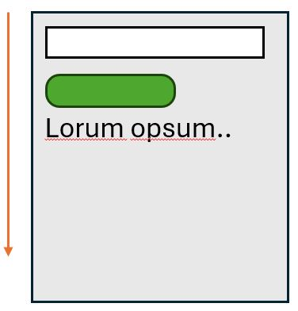
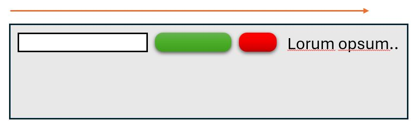
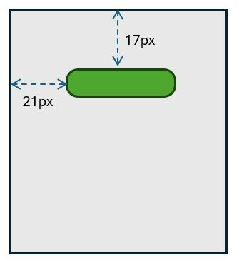
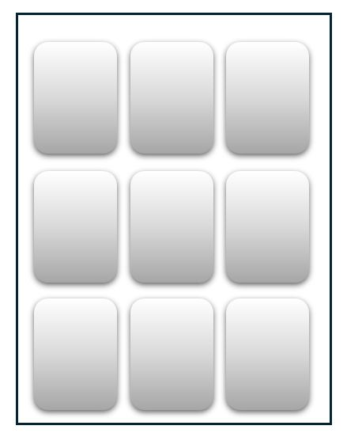
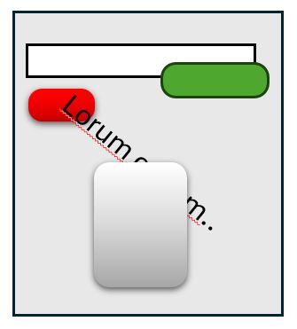
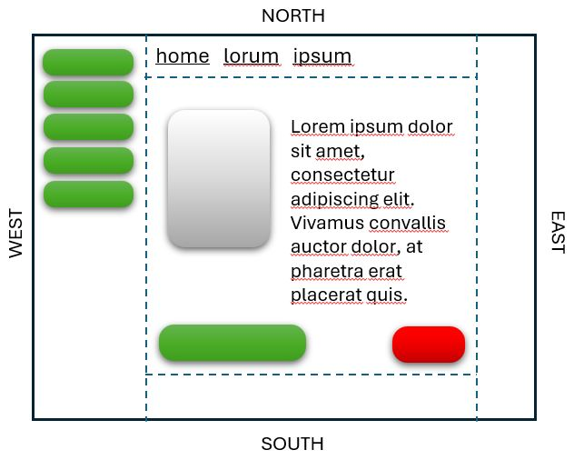
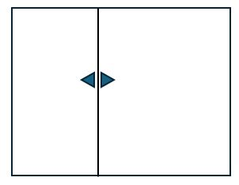
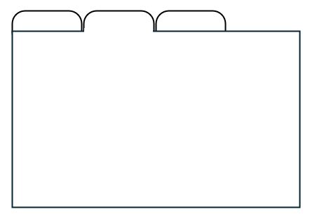
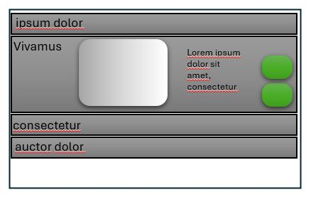
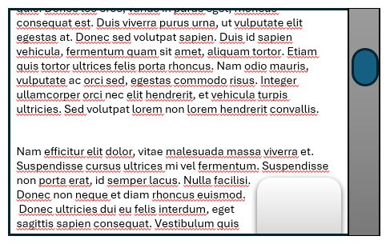

# Layouts in JavaFX

Layout of your application is done with various panes. You have already seen some of them, such as VBox, HBox, and AnchorPane.\
Each pane has specific behaviour and properties. And you can put panes inside other panes, to combine the behaviours and properties of various panes for more complex layouts.

The layouts are:

**VBox** - Arranges children in a vertical column, one below the other. Great for forms and vertical lists of elements.

**HBox** - Arranges children in a horizontal row, side by side. Perfect for button bars and horizontal element groups.

**AnchorPane** - Allows you to anchor children to specific edges (top, bottom, left, right) of the pane. Useful when you need precise control over positioning relative to the container edges.

**GridPane** - Arranges children in a grid of rows and columns, like a spreadsheet. Ideal for forms with labels and inputs aligned in columns, or calculator-style button layouts.

**StackPane** - Stacks children on top of each other, centered by default. Useful for overlaying elements or creating layered effects. The z-order of the children is defined by the order of the children list with the 0th child being the bottom and last child on top

**BorderPane** - Divides the pane into five regions: top, bottom, left, right, and center. Commonly used for application layouts with a menu bar at top, toolbar on left, and main content in center.

**SplitPane** - Divides space between two or more components with a draggable divider. Users can resize sections to their preference.

**TabPane** - Organizes content into tabs that users can switch between. Each tab displays different content in the same space.

**Accordion** - Contains multiple TitledPanes where only one can be expanded at a time. Good for categorized settings or navigation menus.

**ScrollPane** - Wraps content and adds scrollbars when the content is too large to fit. Essential for displaying large amounts of content in a fixed space.

There are more, but you can explore those on your own.

I won't go into further detail about these here. You can read more about them in the [JavaFX documentation](https://docs.oracle.com/javafx/2/layout/builtin_layouts.htm) or [here on Tutorialspoint](https://www.tutorialspoint.com/javafx/javafx_layout_panes.htm).

[This video](https://www.youtube.com/watch?v=GH-3YRAuHs0) also gives a decent overview of the different layouts, it's a bit long, double-speed it.