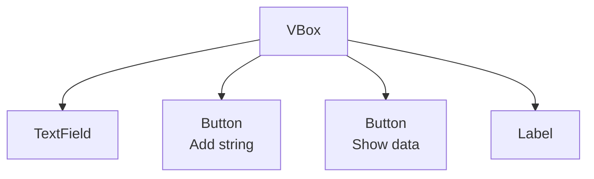
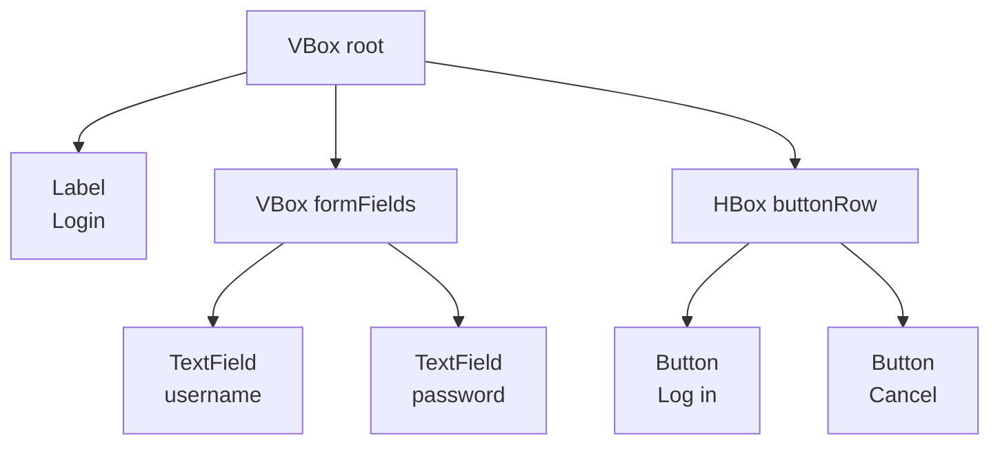

# What is fxml?

So far, you have set up your UI with layout and elements through code. Creating buttons, text fields, labels, etc. and adding them to panes, like VBox, HBox, AnchorPane, etc. Then putting that into a scene, into a stage, and then showing the stage.

While doable, this is tedious. There is another (better?) way.

You can use an fxml file to set up your UI. An fxml file is an XML file that describes your UI. It has similar structure to HTML, but is not HTML.

Let's take the following code. Multiple ui elements are created, and added to a VBox.

```java
TextField textField = new TextField();
Button button = new Button("Add string");
Label dataShowingLabel = new Label();
Button displayDataButton = new Button("Show data");
VBox box = new VBox(textField, button, displayDataButton, dataShowingLabel);
```

That code builds this scene graph — a tree with the `VBox` as the root, and the other controls as its children (top to bottom):



We can describe this in an fxml file like this:

```xml
<VBox>
    <TextField />
    <Button text="Add string" />
    <Label />
    <Button text="Show data" />
</VBox>
```

The tags should be clear, I trust. We have a VBox element, which contains a TextField, a Button, a Label, and another Button.

Is this better? Well, maybe.. 

Now a larger example, where panes sit inside other panes. A title and a small form live in nested boxes:

```java
Label titleLabel = new Label("Login");

TextField usernameField = new TextField();
TextField passwordField = new TextField();
VBox formFields = new VBox(usernameField, passwordField);

Button loginButton = new Button("Log in");
Button cancelButton = new Button("Cancel");
HBox buttonRow = new HBox(loginButton, cancelButton);

VBox root = new VBox(titleLabel, formFields, buttonRow);
```

The scene graph is still a tree — but now some children are panes that have children of their own:



In fxml, that nesting shows up as tags inside tags:

```xml
<VBox>
    <Label text="Login" />
    <VBox>
        <TextField />
        <TextField />
    </VBox>
    <HBox>
        <Button text="Log in" />
        <Button text="Cancel" />
    </HBox>
</VBox>
```

Same structure as the Java code: outer `VBox`, then a nested `VBox` for the fields, then an `HBox` for the buttons.

## SceneBuilder

So, do you have to manually write out the fxml file? No, you can use a tool to help you. There is a drag-and-drop tool called SceneBuilder, which can help you visually setup a scene, and then produce the fxml file for you.
