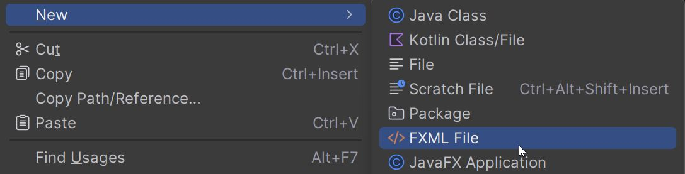

# Exercises - SceneBuilder

Start by watching quick and dirty videos, to see how SceneBuilder works. It's not a deep dive, but it will get you started.

The first will give a brief overview.

<video src="https://youtu.be/j02aTD7AMkA"></video>

Then this one will go through an example of designing a simple UI.

<video src="https://youtu.be/iTMEyaQJxjo"></video>

And lastly, here is how to open fxml files from IntelliJ in SceneBuilder. There _should_ be a button in IntelliJ to do this, but it may not be obvious, and it does not always work. If it fails, you can still open the fxml file in SceneBuilder by just selecting File -> Open in SceneBuilder. Navigate to the fxml file, and click Open. If you don't have an fxml file, you can create these from IntelliJ.

Right-click on any package/folder in your project:

<video src="https://youtu.be/JkONOwnDTDs"></video>

You should now have a decent overview of how to use SceneBuilder.
