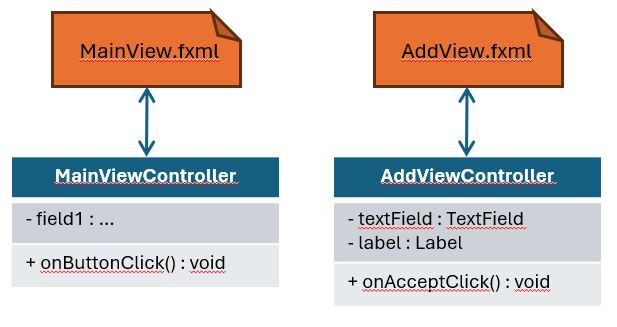
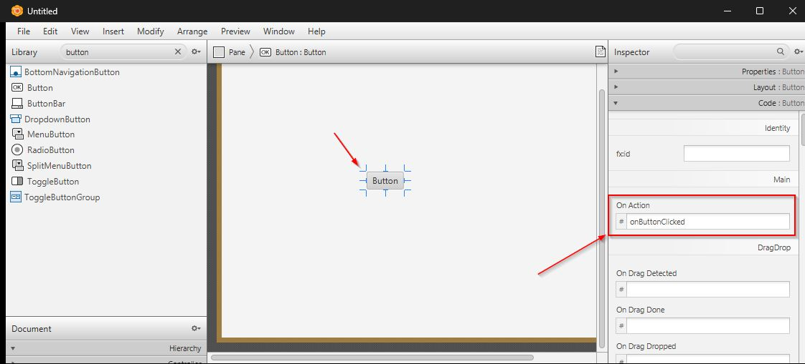

# Controllers

Okay, that's great, we can create a view with elements and layouts and all. But what about the ***behaviour***? The ***actions*** for the buttons, the ***events*** for the text fields, etc.? 

We will use ***controllers*** to handle this.

Controllers are classes that contain the logic for the behaviour of the view. They are responsible for handling the _events_ from the view, and figuring out what and how to present data to the user.

An event is any kind of action that can be caused by the user, or by the system, or by another component. For example: 
- a button click
- a key press
- a mouse move
- a mouse over
- a key down
- a key up
- etc.

Each _view_ in your app will generally be defined by an fxml file. And to each fxml file, you will generally have a controller class:

Each element in the UI can declare that a given (there are _many_ types) event should trigger a method in the controller. For example, a button can be configured to call a method in the controller when it is clicked.  
Or a TextField can be configured to call a method in the controller when the user types in the field.

This is generally configured in the SceneBuilder, and then saved to the fxml file.
All these events are declared in the fxml file, and references a specific method in the controller class.

In the SceneBuilder, you select an element, and on the right side, you can see all the possible events, and put a method name in the field, to be called when the event is triggered.

So, the controllers handle
- Whatever should happen upon some event
- What data should be shown (data is stored in fields in the controller), and formatting that data for presentation
- The state of the UI, sometimes some elements may be disabled, or uneditable, etc.
- Forwarding requests to your DataManager to update your data.

We will start out simple, on the next page.